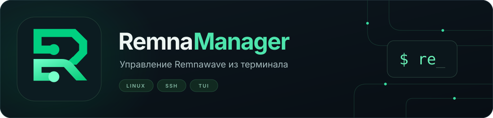
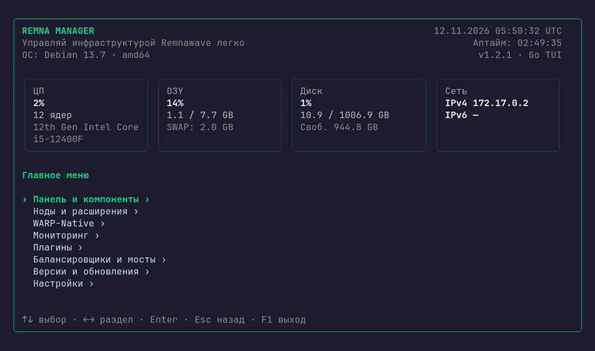

<p align="center">
  
</p>

<p align="center">
  <a href="https://github.com/ConsolePro/RemnaManager/releases"></a>
  
  
</p>

# RemnaManager

**Консольное приложение для установки и обслуживания Remnawave.** Управляйте панелью, нодами, сайтами прикрытия и обновлениями из одного терминального интерфейса по SSH.

Менеджер устанавливает компоненты, сохраняет параметры подключения и выполняет повторяющиеся операции через меню. Для работы с ним не нужны Go, компиляция на сервере или ручное редактирование Docker Compose.



<sub>Снимок реально запущенного TUI в Linux-контейнере, в деморежиме. ОС и системные метрики собираются самим приложением. Это не макет интерфейса.</sub>

## Установка

Нужны **Ubuntu 22.04/24.04 или Debian 12/13**, архитектура **amd64/arm64**, systemd и доступ от root.

```bash
curl -fsSL https://raw.githubusercontent.com/ConsolePro/RemnaManager/main/install.sh | sudo bash
```

[Скрипт установки в репозитории](https://github.com/ConsolePro/RemnaManager/blob/main/install.sh) проверяет систему, определяет архитектуру и актуальный стабильный релиз, скачивает подходящий готовый бинарник из Releases и проверяет SHA256. Go SDK не устанавливается; компиляции на сервере нет.

Запуск меню после установки:

```bash
sudo re
```

Также доступна команда `sudo remanager`. Команда `remna` остаётся свободной для CLI самой панели.

Первый запуск предложит выбрать язык и указать email администратора для выпуска сертификатов. При повторной установке существующие настройки сохраняются, а предыдущий исполняемый файл остаётся для отката.

<details>
<summary>Установка конкретной версии</summary>

```bash
curl -fsSL https://raw.githubusercontent.com/ConsolePro/RemnaManager/main/install.sh | sudo bash -s -- --version v1.2.1
```

Версии и готовые бинарники: [GitHub Releases](https://github.com/ConsolePro/RemnaManager/releases).

</details>

## Что умеет приложение

| Раздел | Возможности |
| --- | --- |
| **Панель и компоненты** | Установка Remnawave, PostgreSQL, Valkey и страницы подписки; выбор Nginx или Caddy; HTTPS; запуск, остановка, логи, обновление backend, резервная копия БД и удаление панели. |
| **Защита панели** | Секретная ссылка с Cookie, отдельный вход TinyAuth или портал с обязательным MFA. Поддерживаются Nginx и Caddy. |
| **Установка нод** | Подключение от root, создание SSH-ключа, Docker, сайт прикрытия, сертификат, профиль VLESS REALITY, регистрация в панели и firewall с откатом. Прерванную установку можно продолжить. |
| **Управление нодами** | Список и статус, переименование, включение и отключение в панели, перезапуск Xray, интерактивный SSH, обновление и переустановка контейнера. |
| **Сайты прикрытия** | Готовые шаблоны selfsteal, смена шаблона с проверкой HTTPS и откатом, автоматическое продление сертификатов через acme.sh. |
| **Обновления** | Отдельное обновление ядра Xray; обновление менеджера из готовых бинарников; выбор версии и локальный откат. |
| **Информация о сервере** | ОС, её версия и архитектура, дата и время, аптайм, CPU, RAM, SWAP, диск и IP-адреса. |

### Установка ноды без постоянных ручных подключений

Укажите адрес сервера и пароль root. Менеджер создаст собственный SSH-ключ и проверит подключение по нему. Пароль не сохраняется; при дальнейших операциях используется ключ. Если вход перестал работать, приложение запросит пароль для восстановления подключения.

Название ноды `FN1501` превращается в профиль и inbound tag `VLESS_REALITY_FN1501`. Хост подписки получает флаг и выбранную страну. **Сквады менеджер не создаёт** — их состав и назначение пользователям вы определяете вручную в панели.

После изменения firewall менеджер сам проверяет новое SSH-соединение. При успешной проверке правила сохраняются, при неудаче срабатывает таймер отката. Файлы новых нод находятся в `/opt/remnanode`.

### Что пока в разработке

WARP-Native, Xray Checker и Telegram-мониторинг, BBR, балансировщики и мосты. Эти пункты меню отмечены «В разработке» и не выполняют системных изменений.

## Перед установкой компонентов

Для панели нужен чистый выделенный сервер, домены панели и страницы подписки с DNS на этот сервер, email администратора и доступные TCP 80/443. TinyAuth и MFA дополнительно используют домен входа.

Для новой ноды нужен отдельный VPS с root SSH и собственный домен сайта прикрытия, направленный на ноду без CDN-проксирования. Мастер проверяет параметры до развёртывания. Установка менеджера сама по себе не запускает установку панели или ноды.

## Управление с клавиатуры

| Клавиши | Действие |
| --- | --- |
| `↑` / `↓`, `Tab` / `Shift+Tab` | Выбор пункта или поля |
| `Enter` | Открыть пункт, продолжить или подтвердить операцию |
| `Esc` | Назад или отменить дальнейшие шаги |
| `F1` / `Ctrl+C` | Выход с подтверждением |

Интерфейс доступен на русском и английском. Минимальный размер терминала — **36×18**, для мастеров удобнее **80×30** и больше. Для копирования используйте `Ctrl+Shift+C` или меню терминала.

## Документация

- [Установка панели](doc/panel-installation.md) и [её защита](doc/panel-protection.md).
- [Установка ноды](doc/node-installation.md) и [управление нодами](doc/node-management.md).
- [Обновление контейнера](doc/node-update.md) и [переустановка ноды](doc/node-reinstall.md).
- [Обновление Xray](doc/node-core-update.md), [файлы ноды и смена сайта](doc/node-files-and-templates.md).
- [Обновление менеджера и откат](doc/manager-update.md).

Настройки менеджера: `/etc/remnamanager/config.json`. Данные Go-установки панели и журналы операций: `/var/lib/remnamanager`. Состояние старой Bash-версии автоматически не импортируется.

## Для разработки

Приложение написано на Go с Bubble Tea, Bubbles и Lip Gloss. Нужен Go 1.26 или новее.

```bash
go build -o bin/remanager ./cmd/remna
./bin/remanager --demo --config ./local-config/config.json
```

`--demo` позволяет изучить интерфейс без установки пакетов и изменения сервисов. Сборка на самом сервере остаётся доступна только при явном выборе: `sudo bash install.sh --source "$PWD"` или `sudo bash install.sh --ref main`.

Проверки перед изменениями:

```bash
go test ./...
go vet ./...
go build ./...
bash -n install.sh
```

В CI также проверяются установка и повторная установка на поддерживаемых дистрибутивах, сохранение настроек, терминальный интерфейс и сценарии восстановления. Исходная Bash-реализация сохранена в ветке [`legacy/bash`](https://github.com/ConsolePro/RemnaManager/tree/legacy/bash).
