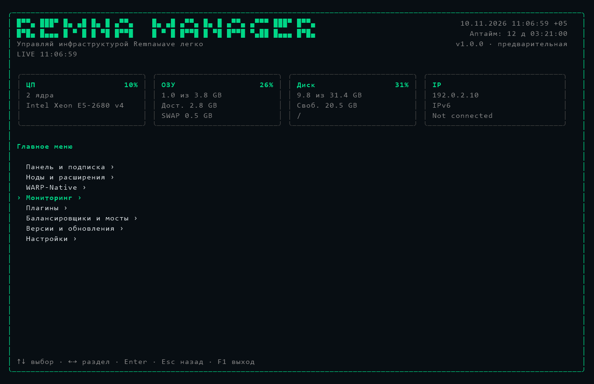
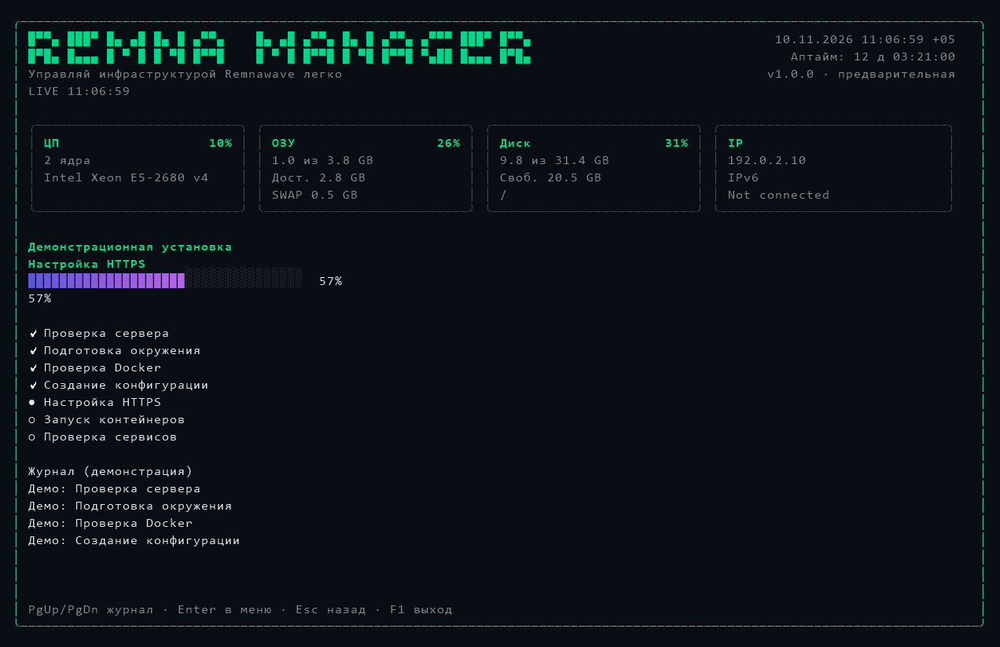

# Классический Go TUI с блоками статистики

Сохранены исходные зелёная рамка, терминальный фон, меню с маркером ›,
клавиатурная навигация и демонстрационный мастер установки.

Предпросмотры используют тестовые данные, а не метрики рабочего сервера.

## Шапка

Слева — REMNA MANAGER и «Управляй инфраструктурой Remnawave легко».
При достаточной ширине название увеличено блочными символами Unicode;
в обычном окне 80 колонок остаётся компактный текст. Изображения, Kitty/Sixel,
дополнительные шрифты и True Color не требуются.

Справа — дата и текущее время с часовым поясом сервера, затем его аптайм,
ниже версия приложения. Используется время того сервера, где запущен remna,
а не часовой пояс SSH-клиента. Время перерисовывается раз в секунду.

Аптайм берётся из `host.UptimeWithContext` (в Linux — время работы ядра),
а не из времени запуска приложения. Между измерениями он продолжает идти
вперёд. До первого ответа сборщика аптайм обозначен «—».

## Блоки статистики

В широком окне четыре блока расположены рядом:

- ЦП: текущая загрузка, число логических CPU с правильным склонением,
  модель процессора из `cpu.InfoWithContext`.
- ОЗУ: процент занятой памяти, занятый объём из общего, доступная память
  и общий объём SWAP. Занятое для этого представления — всего минус доступно.
- Диск: процент, занятый объём из общего, свободное место, файловая система `/`.
  Занятое берётся из `disk.Usage.Used`, чтобы не включать резерв файловой системы.
- IP: IPv4 и IPv6 интерфейсов, либо `Not connected`.

Длинный IPv6 переносится внутри блока. На маленьких экранах используются
две колонки с компактными значениями. Данные собираются асинхронно примерно
раз в секунду. Индикатор LIVE показывает время последнего измерения;
задержки и ошибки выделяются явно.

В контейнере аптайм относится к его ядру Linux (Docker VM), а ресурсы —
к доступному контейнеру окружению. На обычном VPS читаются его системные данные.

## Проверки

Тестируются источник аптайма, формат времени и дней работы, проценты/объёмы,
модель CPU, длинный IPv6, размеры окон, локализация и обновление метрик без
сброса формы. В одноразовых Linux-контейнерах проверяются установка,
повторная установка с сохранением конфига и настоящий PTY: текущие часы,
аптайм, навигация, F1, resize и восстановление терминала.

Результаты локального Docker-прогона 10.11.2026:

| ОС | Установка и повторная установка | Конфиг сохранён | PTY / часы / аптайм / F1 / resize |
|---|---|---|---|
| Debian 12 | PASS | PASS | PASS |
| Debian 13 | PASS | PASS | PASS |
| Ubuntu 22.04 | PASS | PASS | PASS |
| Ubuntu 24.04 | PASS | PASS | PASS |

Для Ubuntu из-за медленной загрузки основного архива использовалось
[зеркало Yandex](https://mirror.yandex.ru/ubuntu/) только внутри одноразовых
контейнеров, с проверками TLS и подписей APT. Установщик проекта и настройки
рабочих контейнеров не менялись. Тестовые контейнеры автоматически удалены.

Также прошли `go build ./...`, `go test ./...`, `go vet ./...` и сборки
для Linux amd64/arm64. PTY-тест отвечает на запросы цвета фона и положения
курсора: сам по себе псевдотерминал не эмулирует ответы настоящего терминала.
